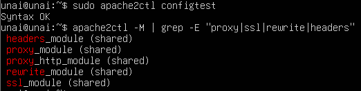

# Práctica 2.1 — Módulos de Apache

## ¿Qué es un módulo y por qué hay que activarlos?

Apache tiene un núcleo pequeño y sus funcionalidades extra se cargan como **módulos**. Ubuntu solo activa unos pocos por defecto, así que hay que habilitar con `a2enmod` los que necesita el proyecto. Así se consume menos memoria y hay menos superficie de ataque.

## Activación

```bash
sudo a2enmod proxy proxy_http ssl rewrite headers
sudo apache2ctl configtest
sudo systemctl restart apache2
```

## Propósito de cada módulo

| Módulo | Para qué sirve | Ejemplo de configuración |
|---|---|---|
| `proxy` | Base del sistema de proxy; lo necesitan los demás módulos `proxy_*` | — |
| `proxy_http` | Reenvía peticiones HTTP a otro servidor (proxy inverso hacia la API FastAPI) | `ProxyPass /api http://127.0.0.1:8000` |
| `ssl` | Habilita HTTPS (cifrado TLS) | `SSLEngine on` |
| `rewrite` | Reescribe y redirige URLs (por ejemplo, HTTP → HTTPS) | `RewriteEngine On` |
| `headers` | Añade o modifica cabeceras HTTP | `Header always set X-Frame-Options "DENY"` |

Otros módulos relevantes que no se han activado: `proxy_wstunnel` (WebSockets), `http2`, `deflate` (compresión) y `proxy_balancer` (balanceo de carga).

## Evidencia

Comando de verificación:

```bash
sudo apache2ctl configtest
apache2ctl -M | grep -E "proxy|ssl|rewrite|headers"
```

