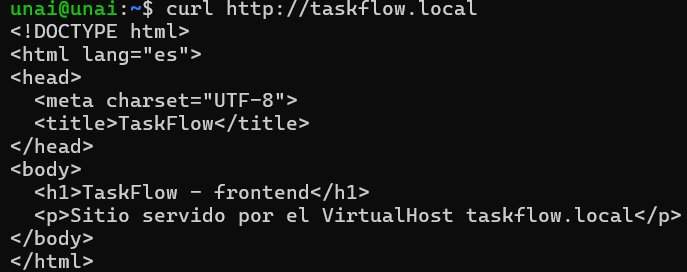
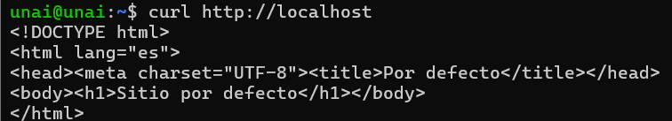
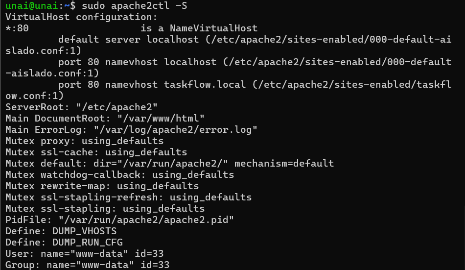
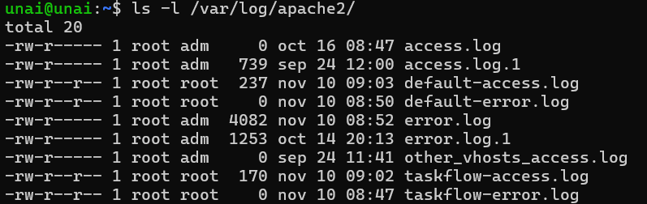

# Práctica 2.2 — Host virtual `taskflow.local`

## ¿Qué es un VirtualHost?

Un VirtualHost permite que un mismo Apache sirva varios sitios distintos. Cuando llega una petición, Apache compara la cabecera `Host` con el `ServerName` de cada VirtualHost y responde con el que coincide. Si ninguno coincide, usa el sitio por defecto. Casos de uso: varios dominios en un mismo servidor o entornos separados (dev/prod).

## Configuración

Fichero `taskflow.conf` (incluido en esta carpeta):

```apache
<VirtualHost *:80>
    ServerName taskflow.local
    DocumentRoot /var/www/taskflow

    <Directory /var/www/taskflow>
        Options -Indexes +FollowSymLinks
        AllowOverride None
        Require all granted
    </Directory>

    ErrorLog  ${APACHE_LOG_DIR}/taskflow-error.log
    CustomLog ${APACHE_LOG_DIR}/taskflow-access.log combined
</VirtualHost>
```

Se creó también un sitio por defecto aislado (`000-default-aislado.conf`) con su propio `DocumentRoot` (`/var/www/default`) y sus propios logs, para que `localhost` no muestre el contenido de TaskFlow.

## Pasos realizados

```bash
sudo a2ensite taskflow.conf
sudo a2ensite 000-default-aislado.conf
sudo a2dissite 000-default.conf
echo "127.0.0.1 taskflow.local" | sudo tee -a /etc/hosts
sudo apache2ctl configtest && sudo systemctl reload apache2
```

## Evidencias

**`taskflow.local` sirve el frontend**



**`localhost` sirve un contenido distinto (aislamiento)**



**VirtualHosts activos**



**Logs separados por sitio**



## Cómo añadir otro host

1. Crear `/etc/apache2/sites-available/otro.conf` con su `ServerName`, `DocumentRoot`, `ErrorLog` y `CustomLog`.
2. Activarlo: `sudo a2ensite otro.conf`
3. Añadir `127.0.0.1 otro.local` a `/etc/hosts`.
4. Recargar: `sudo systemctl reload apache2`