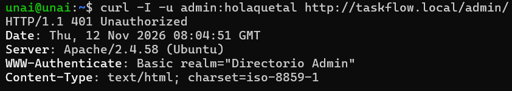
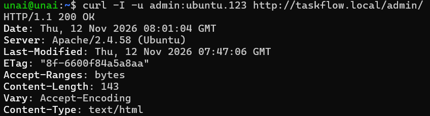
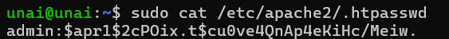
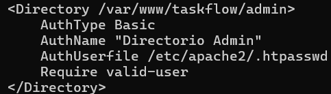

# Práctica 2.3 — Autenticación básica de `/admin`

## Objetivo

Proteger la carpeta `/admin` del sitio `taskflow.local` con autenticación HTTP básica, de forma que solo se pueda acceder con usuario y contraseña.

## ¿Cómo funciona la autenticación básica?

Cuando se pide un recurso protegido, el servidor responde `401 Unauthorized`. El navegador pide usuario y contraseña y los envía en la cabecera `Authorization`, codificados en **Base64**.

Base64 es una codificación, no un cifrado: cualquiera que intercepte la petición puede leer las credenciales. Por eso la autenticación básica **solo es segura sobre HTTPS**.

Existen alternativas más robustas, como la autenticación Digest, los formularios con sesión (cookies) o los tokens JWT.

## Proceso realizado

### 1. Crear la carpeta protegida

```bash
sudo mkdir -p /var/www/taskflow/admin
```

### 2. Crear el fichero de contraseñas

```bash
sudo htpasswd -c /etc/apache2/.htpasswd admin
sudo chown root:www-data /etc/apache2/.htpasswd
sudo chmod 640 /etc/apache2/.htpasswd
```

La opción `-c` crea el fichero y solo se usa la primera vez: si se repite, sobrescribe el fichero y borra los usuarios existentes. La contraseña se guarda cifrada (hash), nunca en texto claro, y el fichero solo puede leerlo `root` y Apache.

### 3. Configurar `taskflow.conf`

Se añadió este bloque dentro del `VirtualHost`:

```apache
<Directory /var/www/taskflow/admin>
    AuthType Basic
    AuthName "Zona restringida"
    AuthUserFile /etc/apache2/.htpasswd
    Require valid-user
</Directory>
```

### 4. Recargar Apache

```bash
sudo apache2ctl configtest
sudo systemctl reload apache2
```

## Verificación

### Acceso sin credenciales → 401

```bash
curl -I http://taskflow.local/admin/
```



Apache rechaza la petición y pide autenticación.

### Acceso con credenciales correctas → 200

```bash
curl -I -u admin http://taskflow.local/admin/
```



Con el usuario y la contraseña correctos se permite el acceso.

> Nota: hay que usar la barra final (`/admin/`). Sin ella, Apache responde con un `301` que redirige a `/admin/`, porque `admin` es una carpeta.

### Fichero de contraseñas

```bash
sudo cat /etc/apache2/.htpasswd
```



Se ve que la contraseña está almacenada como hash y no en texto claro.

### Configuración en Apache



## Política de contraseñas

- Mínimo 12 caracteres, combinando mayúsculas, minúsculas, números y símbolos.
- Sin palabras del diccionario ni datos personales.
- Almacenada solo como hash, con permisos `640` y propietario `root:www-data`.
- Rotación cada 90 días, o de inmediato si hay sospecha de filtración:

```bash
sudo htpasswd /etc/apache2/.htpasswd admin
```

## Gestión de usuarios

```bash
sudo htpasswd /etc/apache2/.htpasswd nuevo_usuario    # añadir usuario
sudo htpasswd /etc/apache2/.htpasswd admin            # cambiar contraseña
sudo htpasswd -D /etc/apache2/.htpasswd nuevo_usuario # eliminar usuario
```

## Conclusión

La zona `/admin` queda protegida: devuelve `401` sin credenciales y `200` con credenciales válidas, mientras el resto del sitio sigue siendo público. Para un entorno real habría que combinarla con HTTPS, ya que la autenticación básica por sí sola no cifra las credenciales.