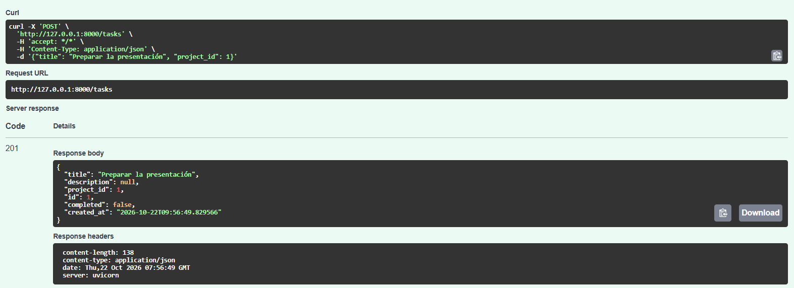
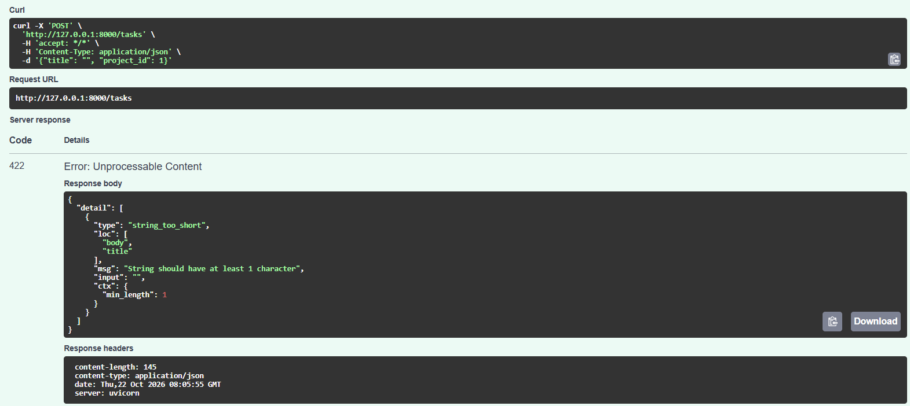

# TaskFlow API — Práctica 1.2: Modelado con Pydantic

Definición de los schemas de entrada/salida del dominio **TaskFlow** (tareas y proyectos) y un endpoint temporal `POST /tasks` para validarlos con FastAPI.

## Estructura

```
Taskflow-api/
├── app/
│   ├── __init__.py
│   ├── schemas.py      # Schemas Pydantic (contrato de la API)
│   └── main.py         # FastAPI + POST /tasks temporal
├── docs/
│   └── evidencias/     # Capturas de Swagger (caso válido e inválido)
├── requirements.txt
└── README.md
```

## Schemas

| Schema          | Campos                                                              |
|-----------------|---------------------------------------------------------------------|
| `TaskCreate`    | `title` (1–100 car.), `description` (opcional), `project_id` (> 0)  |
| `TaskRead`      | Los de `TaskCreate` + `id`, `completed`, `created_at`               |
| `ProjectCreate` | `name` (1–100 car.), `description` (opcional)                       |
| `ProjectRead`   | Los de `ProjectCreate` + `id`, `created_at`                         |

> **Schema ≠ modelo de BD.** Los schemas son el *contrato* de la API (qué entra y qué sale). Los modelos de base de datos (persistencia) se definirán más adelante.

## Cómo ejecutarlo

```powershell
python -m venv .venv
.\.venv\Scripts\Activate.ps1
pip install -r requirements.txt
uvicorn app.main:app --reload
```

Documentación interactiva (Swagger): <http://127.0.0.1:8000/docs>

## Endpoint temporal

`POST /tasks` recibe un `TaskCreate` y devuelve un `TaskRead` simulado con código **201**. No guarda nada.

### Caso válido

Petición:

```json
{ "title": "Preparar la presentación", "project_id": 1 }
```

Respuesta `201 Created`:



### Caso inválido (título vacío)

Petición:

```json
{ "title": "", "project_id": 1 }
```

Respuesta `422 Unprocessable Entity`, con el detalle del error:

