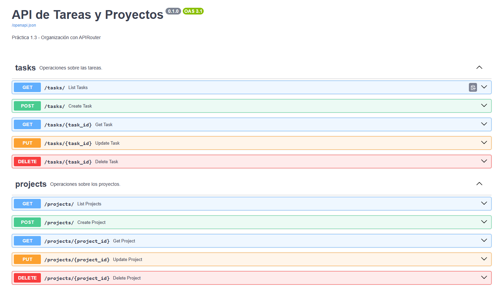
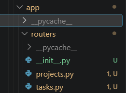

# Taskflow API

API REST con FastAPI para gestionar tareas y proyectos.
Práctica 1.3: Organización con APIRouter.

## Instalación y ejecución

```powershell
python -m venv .venv
.venv\Scripts\activate
pip install -r requirements.txt
uvicorn app.main:app --reload
```


## Estructura del proyecto

```
Taskflow-api/
├── app/
│   ├── __init__.py
│   ├── main.py            # Instancia la app y registra los routers
│   └── routers/
│       ├── __init__.py
│       ├── tasks.py       # Endpoints de /tasks
│       └── projects.py    # Endpoints de /projects
├── docs/
│   ├── estructura.png     # Captura de la estructura de routers/
│   └── swagger.png        # Captura de Swagger agrupado por tags
├── .gitignore
├── requirements.txt
└── README.md
```

## Por qué separar las rutas por recurso

- **Legibilidad:** cada archivo tiene una única responsabilidad.
- **Trabajo en equipo:** varias personas pueden editar recursos distintos sin conflictos en Git.
- **Mantenimiento:** localizar y corregir un endpoint es inmediato.
- **Escalabilidad:** añadir un recurso nuevo es crear un router nuevo, sin tocar el resto.
- **Swagger ordenado:** los endpoints aparecen agrupados por tag.

## Monolito vs. diseño modular

Con todo en un único `main.py`, el archivo crece sin control, es difícil de leer,
provoca conflictos al trabajar en equipo y cualquier cambio arriesga romper otra parte.
Con routers, el coste inicial es algo mayor (más archivos e imports), pero el
mantenimiento a largo plazo es mucho más barato.

## Justificación de la estructura

Se usa un router por recurso (`tasks`, `projects`) con su propio prefijo y tag.
`main.py` solo configura la aplicación e incluye los routers, sin lógica de negocio.

## Capturas

### Swagger agrupado por tags



### Estructura de la carpeta routers/

