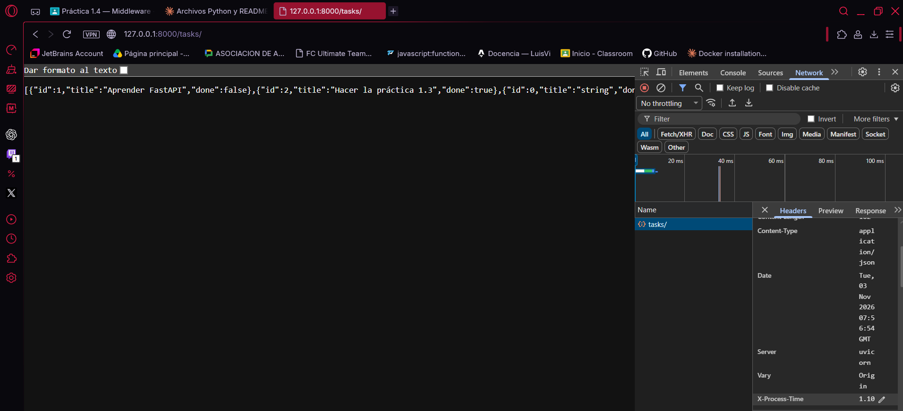
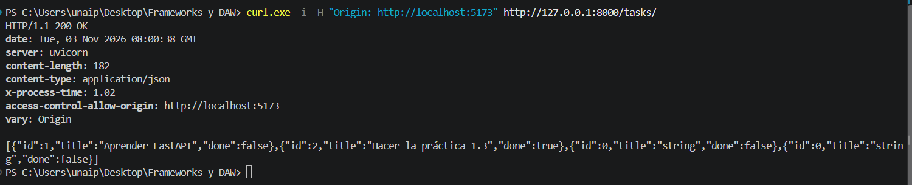
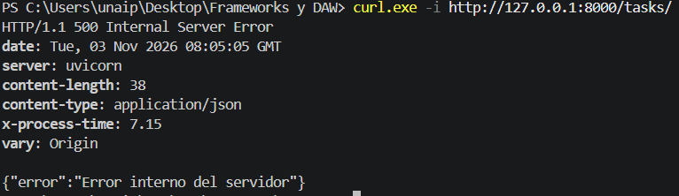

# Taskflow API - Práctica 1.4: Middleware

API REST con FastAPI para gestionar tareas y proyectos.
Práctica 1.4: comportamiento transversal con middleware.

## Instalación y ejecución

```powershell
python -m venv .venv
.venv\Scripts\activate
pip install -r requirements.txt
uvicorn app.main:app --reload
```

Documentación interactiva (Swagger): http://127.0.0.1:8000/docs

## Estructura del proyecto

```
Taskflow-api/
├── app/
│   ├── __init__.py
│   ├── main.py            
│   ├── middleware.py     
│   └── routers/
│       ├── __init__.py
│       ├── tasks.py
│       └── projects.py
├── docs/                   
├── .gitignore
├── requirements.txt
└── README.md
```

## Qué es un middleware

Un middleware es código que se ejecuta en **cada** petición, antes y después
del endpoint. Sirve para comportamiento transversal (CORS, medir tiempos,
controlar errores) sin repetirlo en cada ruta.

## Qué se ha implementado

- **CORS** (`main.py`): solo permite el origen `http://localhost:5173`, con
  métodos GET, POST, PUT y DELETE y los headers Content-Type y Authorization.
- **X-Process-Time** (`middleware.py`): añade a toda respuesta el tiempo de
  procesado en milisegundos.
- **Handler global de excepciones** (`middleware.py`): cualquier excepción no
  controlada devuelve `{"error": "Error interno del servidor"}` con código 500.
  El stacktrace nunca se envía al cliente.

## Orden de ejecución

La petición atraviesa las capas de fuera hacia dentro: CORS, después el
middleware de tiempo y por último el endpoint. La respuesta recorre el mismo
camino a la inversa. El middleware que se registra el último es el más externo.

## Capturas

### 1. Cabecera X-Process-Time en una respuesta normal



### 2. CORS permitido para http://localhost:5173



### 3. Excepción forzada: respuesta 500 sin stacktrace

