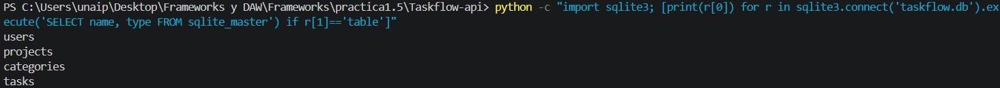
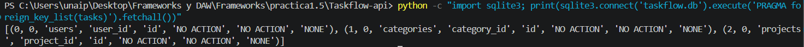

# Taskflow API - Práctica 1.5: Modelos SQLAlchemy y conexión a BD

API REST con FastAPI para gestionar tareas y proyectos.
Práctica 1.5: persistencia de datos reales en SQLite con SQLAlchemy.

## Instalación y ejecución

```powershell
python -m venv .venv
.venv\Scripts\activate
pip install -r requirements.txt
uvicorn app.main:app --reload
```

Documentación interactiva (Swagger): http://127.0.0.1:8000/docs

Al arrancar, la aplicación crea automáticamente el archivo `taskflow.db` con las tablas.

## Estructura del proyecto

```
Taskflow-api/
├── app/
│   ├── __init__.py
│   ├── main.py            # Configura la app, middleware y crea las tablas
│   ├── middleware.py      # Middleware X-Process-Time + handler global de excepciones
│   ├── database.py        # Engine, SessionLocal, Base y dependencia get_db()
│   ├── models.py          # Modelos SQLAlchemy: User, Project, Category, Task
│   └── routers/
│       ├── __init__.py
│       ├── tasks.py
│       └── projects.py
├── docs/                  # Capturas de la práctica
├── .gitignore
├── requirements.txt
└── README.md
```

## Qué es un ORM

Un ORM (Object-Relational Mapping) traduce entre objetos de Python y tablas de
una base de datos. En SQLAlchemy, cada clase (`Task`, `Project`...) es una tabla,
cada atributo `Column` es una columna y cada objeto creado es una fila.

**Ventaja:** se trabaja con objetos Python en lugar de escribir SQL a mano, el
código es más legible y se evitan errores e inyecciones SQL.

## Conexión a la base de datos (`database.py`)

- **`engine`**: conexión con SQLite (`sqlite:///./taskflow.db`). Se usa
  `check_same_thread=False` porque FastAPI puede atender una petición en un hilo
  distinto al que abrió la conexión, y SQLite por defecto lo prohíbe.
- **`SessionLocal`**: fábrica de sesiones; cada petición usa su propia sesión.
- **`get_db()`**: dependencia de FastAPI que entrega una sesión con `yield` y la
  cierra siempre en un bloque `finally`, incluso si la petición falla. Así no
  quedan conexiones abiertas.

## Modelos y relaciones (`models.py`)

- Un `Project` tiene muchas `Task` (1-N), mediante `Task.project_id`.
- Una `Category` agrupa muchas `Task` (1-N), mediante `Task.category_id`.
- Un `User` tiene muchas `Task` (1-N), mediante `Task.user_id`.
- `Project` no tiene dueño: todos los usuarios pueden acceder a todos los proyectos.

## Capturas

### 1. Tablas creadas en taskflow.db



### 2. Clave foránea de Task a Project

