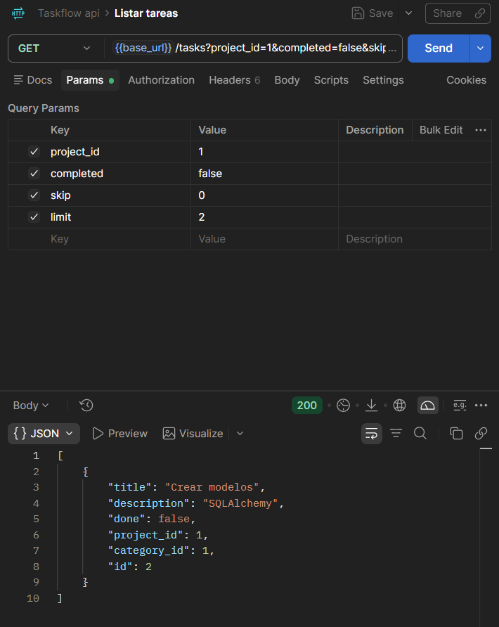
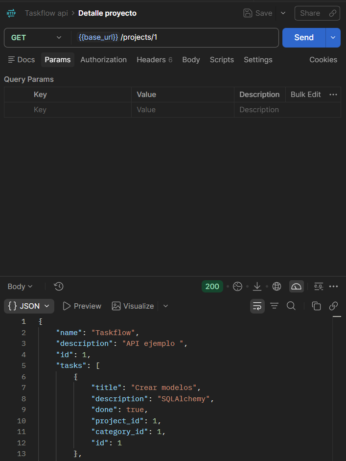
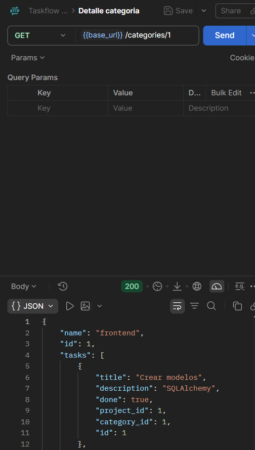
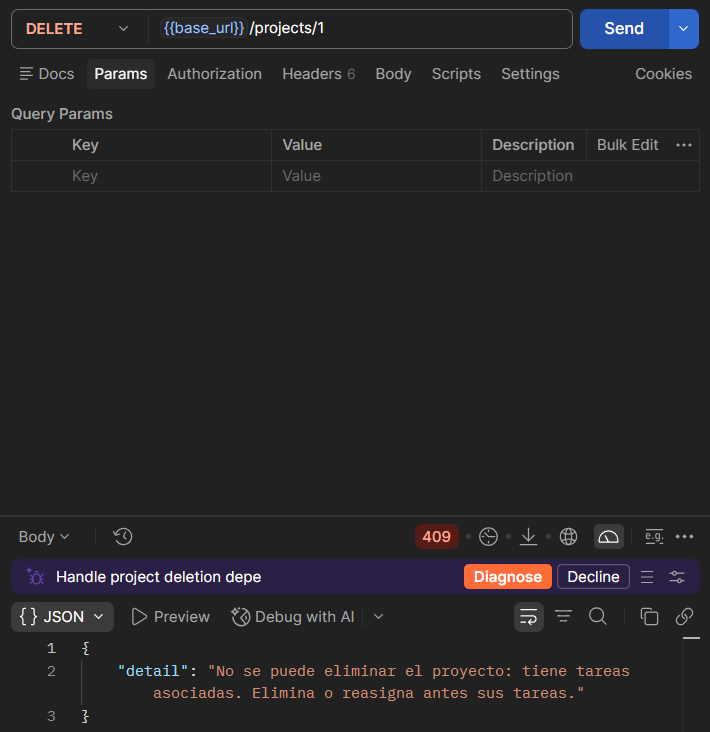
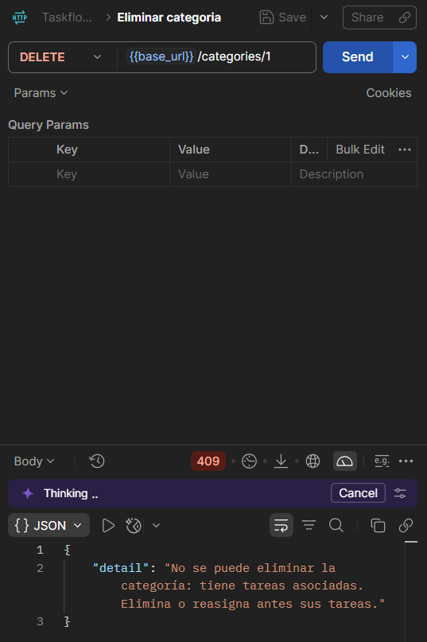
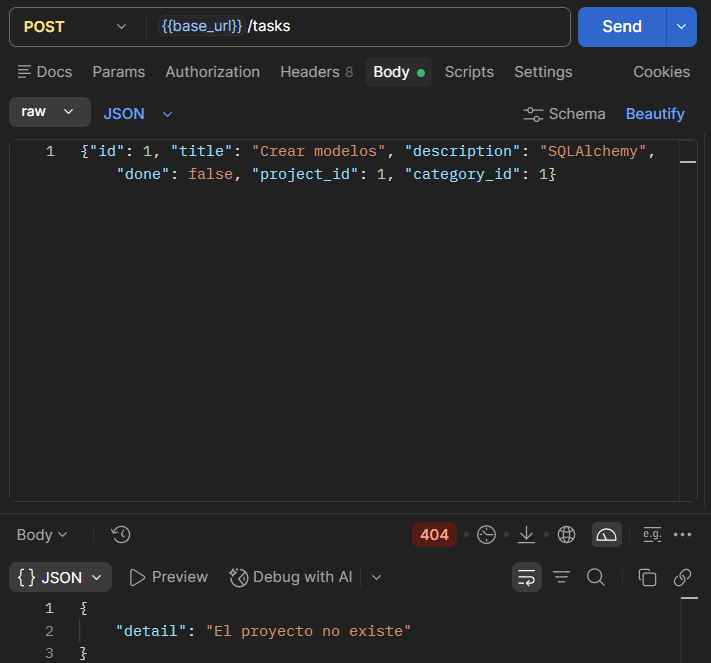
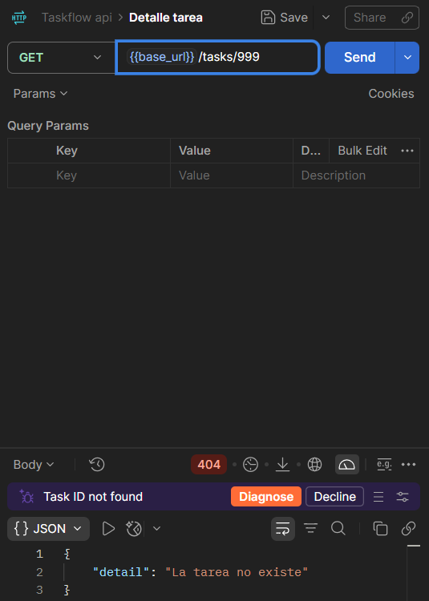
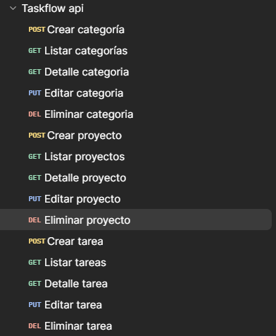

# Taskflow API - Práctica 1.6: CRUD completo

API REST con FastAPI y SQLAlchemy (SQLite) para gestionar **tareas**, **proyectos** y **categorías**.
Práctica 1.6: implementación de las operaciones CRUD reales sobre la base de datos.

## Instalación y ejecución

```powershell
python -m venv .venv
.venv\Scripts\activate
pip install -r requirements.txt
uvicorn app.main:app --reload
```

- Documentación interactiva (Swagger): http://127.0.0.1:8000/docs
- Al arrancar se crea automáticamente `taskflow.db` con las tablas.

## Estructura del proyecto

```
Taskflow-api/
├── app/
│   ├── __init__.py
│   ├── main.py            # Configura la app, CORS, middleware y registra los routers
│   ├── middleware.py      # Middleware X-Process-Time + handler global de excepciones
│   ├── database.py        # Engine, SessionLocal, Base y dependencia get_db()
│   ├── models.py          # Modelos SQLAlchemy: User, Project, Category, Task
│   ├── schemas.py         # Schemas Pydantic (entrada y salida de la API)
│   └── routers/
│       ├── __init__.py
│       ├── tasks.py       # CRUD de /tasks con filtros y paginación
│       ├── projects.py    # CRUD de /projects
│       └── categories.py  # CRUD de /categories
├── docs/                  # Capturas y colección de Postman
├── .gitignore
├── requirements.txt
└── README.md
```

## Contrato de la API

| Método | Ruta | Descripción | Respuesta |
|---|---|---|---|
| GET | `/tasks` | Lista tareas (filtros: `project_id`, `completed`; paginación: `skip`, `limit`) | 200 |
| GET | `/tasks/{id}` | Detalle de una tarea | 200 / 404 |
| POST | `/tasks` | Crea una tarea | 201 / 404 |
| PUT | `/tasks/{id}` | Edita una tarea | 200 / 404 |
| DELETE | `/tasks/{id}` | Elimina una tarea | 204 / 404 |
| GET | `/projects` | Lista proyectos | 200 |
| GET | `/projects/{id}` | Detalle de un proyecto **con sus tareas** | 200 / 404 |
| POST | `/projects` | Crea un proyecto | 201 |
| PUT | `/projects/{id}` | Edita un proyecto | 200 / 404 |
| DELETE | `/projects/{id}` | Elimina un proyecto | 204 / 404 / 409 |
| GET | `/categories` | Lista categorías | 200 |
| GET | `/categories/{id}` | Detalle de una categoría **con sus tareas** | 200 / 404 |
| POST | `/categories` | Crea una categoría | 201 / 409 |
| PUT | `/categories/{id}` | Edita una categoría | 200 / 404 / 409 |
| DELETE | `/categories/{id}` | Elimina una categoría | 204 / 404 / 409 |

### Filtros y paginación en `GET /tasks`

| Parámetro | Tipo | Descripción |
|---|---|---|
| `project_id` | entero (opcional) | Devuelve solo las tareas de ese proyecto |
| `completed` | booleano (opcional) | Filtra por tareas completadas o pendientes (columna `done`) |
| `skip` | entero >= 0 (por defecto 0) | Número de tareas que se saltan |
| `limit` | entero 1-100 (por defecto 10) | Número máximo de tareas devueltas |

Ejemplo: `GET /tasks?project_id=1&completed=false&skip=0&limit=2`

Los resultados se ordenan por `id`, para que la paginación sea estable.

## Gestión de relaciones al borrar: bloqueo (409)

Al eliminar un **proyecto** o una **categoría** que todavía tiene tareas asociadas,
la API **no lo elimina** y devuelve `409 Conflict` con un mensaje claro.

**Justificación de la decisión:**

- Borrar en cascada destruiría tareas del usuario sin que sea consciente de ello.
- Una tarea no puede existir sin proyecto (`project_id` no admite `NULL`), por lo que
  tampoco es posible dejarla huérfana.
- Con el bloqueo, el usuario decide antes qué hacer con sus tareas: eliminarlas o
  reasignarlas.

Cuando el proyecto o la categoría no tienen tareas, se eliminan con normalidad (204).

## Manejo de errores

| Situación | Código | Mensaje |
|---|---|---|
| Tarea inexistente | 404 | `La tarea no existe` |
| Proyecto inexistente | 404 | `El proyecto no existe` |
| Categoría inexistente | 404 | `La categoría no existe` |
| Crear tarea con proyecto o categoría inexistente | 404 | `El proyecto no existe` / `La categoría no existe` |
| Nombre de categoría duplicado | 409 | `Ya existe una categoría con ese nombre` |
| Borrar proyecto o categoría con tareas | 409 | `No se puede eliminar ... tiene tareas asociadas` |
| Excepción no controlada | 500 | `{"error": "Error interno del servidor"}` (sin stacktrace) |

SQLite no comprueba las claves foráneas por defecto, por lo que la existencia del
proyecto y de la categoría se valida a mano antes de guardar una tarea.

## Colección de Postman

La colección `docs/taskflow.postman_collection.json` contiene las **15 peticiones**
de la API (5 por recurso). La variable `base_url` vale `http://127.0.0.1:8000`.

> Nota: la colección se generó a partir de las 15 peticiones probadas en Postman,
> porque la versión utilizada no permitía exportarla directamente.

Para usarla: en Postman, **Import** y seleccionar el archivo JSON.
Orden recomendado: crear categoría, proyecto y tarea; después lecturas y ediciones;
y los borrados al final. No conviene ejecutar la colección entera de golpe, porque las
peticiones de borrado eliminarían los datos que necesitan otras peticiones.

## Capturas de las pruebas

### Filtros y paginación

`GET /tasks?project_id=1&completed=false&skip=0&limit=2` devuelve solo 2 tareas.



### Proyecto con sus tareas

`GET /projects/{id}` incluye la lista de tareas asociadas.



### Categoría con sus tareas

`GET /categories/{id}` incluye la lista de tareas asociadas.



### Borrado bloqueado (409)

Eliminar un proyecto con tareas devuelve 409 y un mensaje claro.



### Borrado de categoría bloqueado (409)

Eliminar una categoría con tareas también devuelve 409 y un mensaje claro.



### Tarea con proyecto inexistente (404)

No se puede crear una tarea asociada a un proyecto que no existe.



### Recurso inexistente (404)



### Colección de Postman

